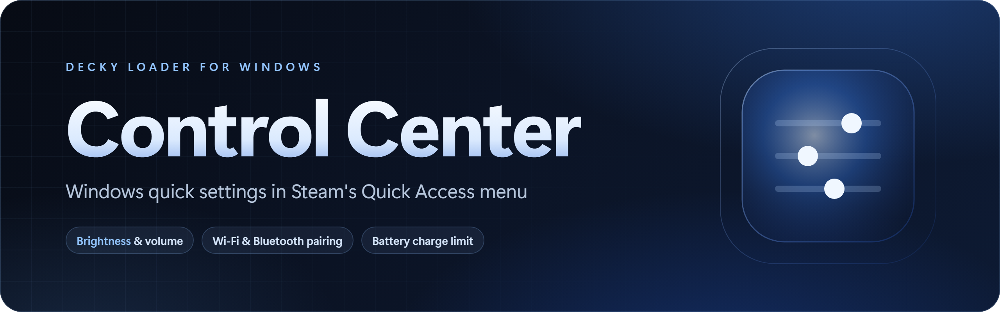
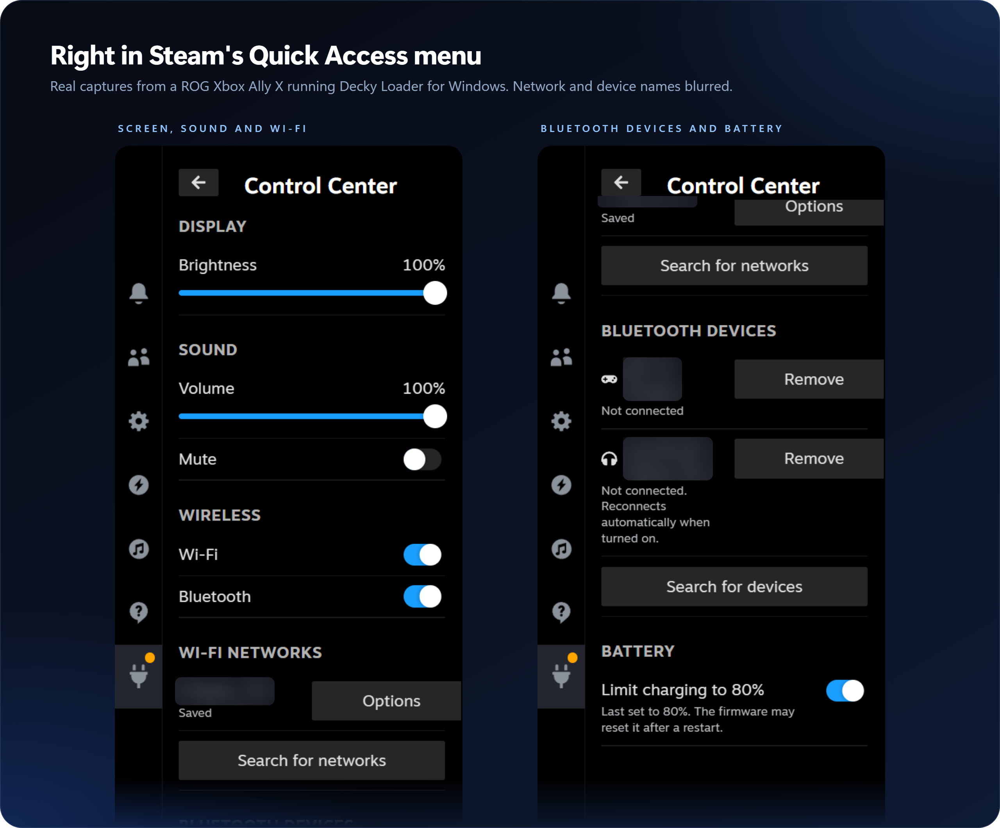
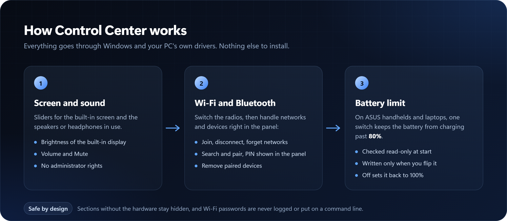

<p align="center">
  
</p>

<p align="center">
  <a href="https://github.com/musika08/decky-control-center/releases/latest"></a>
  <a href="https://github.com/musika08/decky-control-center/releases"></a>
  <a href="LICENSE"></a>
  <a href="https://ko-fi.com/musika"></a>
</p>

<p align="center">
  <b>Windows quick settings without leaving Steam.</b><br>
  Control Center puts brightness, volume, Wi-Fi, Bluetooth and the ASUS battery charge limit in the Quick Access menu, so you never need the Windows desktop for them.
</p>

<p align="center">
  <a href="#install">Install</a> &nbsp;·&nbsp;
  <a href="#use">Use</a> &nbsp;·&nbsp;
  <a href="#how-it-works">How it works</a> &nbsp;·&nbsp;
  <a href="#tested">Tested</a> &nbsp;·&nbsp;
  <a href="#faq">FAQ</a> &nbsp;·&nbsp;
  <a href="#support">Support</a>
</p>

<br>

<table>
  <tr>
    <td width="25%" valign="top"><b>Screen and sound</b><br><sub>Brightness of the built-in display, plus volume and mute for the speakers or headphones in use.</sub></td>
    <td width="25%" valign="top"><b>Wi-Fi</b><br><sub>Wi-Fi on or off, saved networks, search, and joining a new network with its password.</sub></td>
    <td width="25%" valign="top"><b>Bluetooth</b><br><sub>Bluetooth on or off, search and pair new devices (PIN shown in the panel), and remove old ones.</sub></td>
    <td width="25%" valign="top"><b>Battery limit</b><br><sub>On ASUS handhelds and laptops, one switch stops charging at 80% to spare the battery.</sub></td>
  </tr>
</table>

<p align="center">
  
</p>

> [!NOTE]
> **Formerly Windows Quick Settings.** The plugin folder is now `control-center` (it was `windows-quick-settings`). The Decky Loader for Windows dashboard moves an old install and its settings over.

## Install

1. Install Decky Loader for Windows on your handheld or PC. *(Public download coming soon.)*
2. In Decky, open the **Store**, find **Control Center** and install it.

Or install the zip from the [latest release](https://github.com/musika08/decky-control-center/releases/latest) by hand.

On another Decky build, add the store list yourself: Decky settings, Store, **Custom**, then enter `https://musika08.github.io/decky-windows-store/plugins`. That address is for Decky to read; opening it in a browser only shows the raw plugin list.

## Use

1. Open the Quick Access menu, then **Decky**, then **Control Center**.
2. Drag **Brightness** and **Volume**, or flip **Mute**.
3. Turn **Wi-Fi** and **Bluetooth** on or off under **Wireless**.
4. Under **Wi-Fi networks**, tap **Options** next to a saved network for **Connect** or **Forget**, or tap **Search for networks** and pick one. A secured network asks for its password (the Steam keyboard works, with **Show password**).
5. Under **Bluetooth devices**, tap **Search for devices** and tap the one you want to pair. If it shows a PIN, check that it matches the device and tap **PIN matches, pair**. **Remove** next to a paired device removes it after you confirm.
6. Under **Battery**, turn on **Limit charging to 80%**. Turn it off to charge to 100% again.

A section is hidden when your PC doesn't have that hardware: no brightness on a desktop with only external monitors, no volume without a playback device, no Wi-Fi or Bluetooth without the radio, and no battery limit on anything that is not an ASUS laptop or handheld.

## How it works

<p align="center">
  
</p>

<details>
<summary><b>What each control uses</b></summary>
<br>

| Section | Control | How | Admin |
|---|---|---|---|
| Display | Brightness slider | WMI `root\wmi` `WmiMonitorBrightness` (read) and `WmiMonitorBrightnessMethods.WmiSetBrightness` (write), through Windows PowerShell | No |
| Sound | Volume slider, Mute | Core Audio `IAudioEndpointVolume` of the default playback device, called from Python with `ctypes` (no comtypes or pywin32) | No |
| Wireless | Wi-Fi, Bluetooth on/off | WinRT `Windows.Devices.Radios` through Windows PowerShell 5.1 (the radio itself, not airplane mode or adapters) | No |
| Wi-Fi networks | Current network, Disconnect, saved networks (Connect, Forget), Search, Connect with password | Windows' built-in `netsh wlan`, started directly (no shell, no window, 15-second limit per call) | No |
| Bluetooth devices | Paired list, Search, Pair, Remove | WinRT `Windows.Devices.Enumeration` (`DeviceWatcher`, `DeviceInformationCustomPairing`, `UnpairAsync`) through Windows PowerShell 5.1 | No |
| Battery | Limit charging to 80% | ASUS ATKACPI driver (`\\.\ATKACPI`, IOCTL `0x0022240C`, `DEVS` on device `0x00120057`), as in G-Helper | See the FAQ |

**Wi-Fi.** Search reads the list Windows keeps from its own background scans every 3 seconds (netsh has no command to start a scan), until **Stop search** or the panel closes. To join a new secured network, the plugin writes a WLAN profile (WPA2-Personal, WPA3-Personal (SAE), WPA2/WPA3 transition, or open) to a file in a new randomly named folder under `%LOCALAPPDATA%`, runs `netsh wlan add profile`, and deletes the file and folder in every case. It then connects and waits up to 15 seconds for Windows to report the network as connected. A wrong password removes the new profile again. The password is never logged, never put on a command line and never sent back to the panel.

**Bluetooth.** Search and pairing each run in a Windows PowerShell helper process that talks to the plugin in JSON lines. Search stops by itself after 30 seconds. Pairing runs in the panel, never in a Windows dialog (that would open behind Big Picture): "confirm only" requests are accepted at once, a PIN to compare waits up to 60 seconds for your answer, a PIN to type on the device is shown in the panel, and an attempt ends by itself after 120 seconds. The pairing handler is compiled in memory from `System.Linq.Expressions` (no compiler, no file on disk), because Windows only accepts an answer given on its own event thread.

**Battery.** Once per start, the plugin sends a read-only `DSTS` for device `0x00120057` and shows the switch only when the firmware reports it present. A write (`DEVS`) happens only when you flip the switch: on sets 80%, off sets 100%. The firmware doesn't report the current limit, so the panel shows the last value it set.

</details>

## Tested

| Device | Windows | Result |
|---|---|---|
| ROG Xbox Ally X | Windows 11 | Brightness, volume and mute, Wi-Fi and Bluetooth switches, saved Wi-Fi networks, paired Bluetooth devices and the 80% battery limit, as in the captures above |

## FAQ

<details>
<summary><b>Why is a section missing?</b></summary>
<br>
Each section shows only when its hardware is there. Brightness works for built-in screens (external monitors have no WMI brightness), volume needs a playback device, Wi-Fi and Bluetooth need their radio, and the battery limit needs an ASUS PC whose firmware has the charge-limit device. When Wi-Fi or Bluetooth is off, its section only says so.
</details>

<details>
<summary><b>Search for networks finds nothing.</b></summary>
<br>
On current Windows 11, Windows only lets apps read Wi-Fi information when <b>Location</b> is on for desktop apps. The panel then says "Turn on Location in Windows Settings to search for networks". Saved networks can still be connected and forgotten.
</details>

<details>
<summary><b>Which Wi-Fi networks can't I join here?</b></summary>
<br>
Hidden networks, 802.1X / Enterprise networks (connect those from Windows Settings), and WEP, WPA (version 1) and Enhanced Open (OWE) networks. Networks set by group policy can be connected but not forgotten.
</details>

<details>
<summary><b>Why is there no Connect button for my Bluetooth headphones?</b></summary>
<br>
Windows has no public way for apps to connect or disconnect a paired Bluetooth audio device. Paired devices reconnect by themselves when you turn them on; audio devices say so in their status line. Devices that need a PIN typed in on the PC side, or a user name and password, can't be paired here yet.
</details>

<details>
<summary><b>Pairing fails at once every time.</b></summary>
<br>
A pairing that didn't finish can leave Windows' pairing service stuck; the panel then says "Windows is still busy with an earlier pairing". Turning Bluetooth off and on may clear it; if not, restart the PC.
</details>

<details>
<summary><b>The battery limit went back to 100% after a restart.</b></summary>
<br>
Many ASUS models reset the limit when they restart, and the firmware doesn't report the current value. Turn the switch off and on again after a restart if needed.
</details>

<details>
<summary><b>The battery switch doesn't appear on my ASUS.</b></summary>
<br>
The plugin runs without administrator rights. Check the PC by hand, read-only, with <code>python -I py_modules\wqs\asus_acpi.py --probe</code>: it prints JSON whose <code>reason</code> is <code>ok</code>, <code>not_present</code>, <code>no_driver</code>, <code>access_denied</code> or <code>error</code>. If it reports <code>access_denied</code> without administrator rights but works with them, add <code>"root"</code> to <code>flags</code> in <code>plugin.json</code>; in Decky's installed mode the plugin then runs with administrator rights.
</details>

## Support

If Control Center saves you a trip to the Windows desktop, you can support its development:

<p>
  <a href="https://ko-fi.com/musika"></a>
</p>

## Credits

- [G-Helper](https://github.com/seerge/g-helper), whose ATKACPI calls the battery charge limit follows.
- [Decky Loader](https://github.com/SteamDeckHomebrew/decky-loader) by the Steam Deck Homebrew team.

Control Center is unofficial and not affiliated with Microsoft, ASUS or Valve. Licensed GPL-3.0-only; see [`LICENSE`](LICENSE).

<details>
<summary><b>For developers: build and test</b></summary>
<br>

The frontend is built with the packages from a Decky Loader checkout; nothing is installed. Link them, then build:

```
New-Item -ItemType Junction -Path node_modules -Target <decky-loader>\frontend\node_modules
npm run typecheck
npm run build
```

`npm run build` writes `dist/index.js`. A plugin folder for Decky contains `plugin.json`, `package.json`, `main.py`, `py_modules` and `dist`. `tools\render-assets.ps1` re-renders the README images from `.github\assets\src`.

Tests (none touch the real brightness, volume, radios, Wi-Fi, Bluetooth devices or ACPI device; the backend helpers take injected runners, and the Wi-Fi tests answer netsh calls with recorded-style output):

```
python -m pytest -q tests
```

On Windows, one test also compiles the real pairing handler against stub types (`tests/pair_handler_stub.ps1`) and fires it on thread-pool threads, and another parses (without running) the search and pairing helper scripts with PowerShell's parser; neither touches Bluetooth.

</details>
